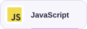

[English](README.md) · **Español**

<picture>
  <source media="(prefers-color-scheme: dark)" srcset="assets/profile/constellation-dark.svg">
  <source media="(prefers-color-scheme: light)" srcset="assets/profile/constellation-light.svg">
  
</picture>

# Hola, soy Angel 👋

### Tester Sr · Automatización de pruebas

**Herramientas Python · Pruebas web y API · Arquitectura de pruebas**

[🌐 Portafolio](https://angel-valdezzz.github.io/es/) &nbsp; · &nbsp; [🧩 Proyectos](#proyectos) &nbsp; · &nbsp; [📄 CV](https://angel-valdezzz.github.io/cv/angel-es.pdf) &nbsp; · &nbsp; [✉️ Contacto](mailto:angelgerardomolinavaldez@gmail.com)

## Sobre mí

Desarrollo **herramientas Python y frameworks de automatización** que facilitan crear, ejecutar y entender las pruebas. Tengo **más de 5 años de experiencia** en pruebas automatizadas y actualmente soy **Tester Sr en EPAM Neoris, trabajando con AXA**.

Me enfoco en arquitectura de pruebas, automatización web y API, infraestructura de ejecución, reportes y mentoría técnica. Estoy avanzando hacia un **rol SDET (Software Development Engineer in Test)** mediante diseño de software y herramientas reutilizables.

## Tecnologías

Lenguajes y herramientas con los que trabajo y conocimientos que forman parte de mi base técnica. Despliega cada grupo para ver cómo los uso.

### Lenguajes y consultas

<picture>
  <source media="(prefers-color-scheme: dark)" srcset="assets/profile/badges/python-dark.svg">
  <source media="(prefers-color-scheme: light)" srcset="assets/profile/badges/python-light.svg">
  
</picture>
<picture>
  <source media="(prefers-color-scheme: dark)" srcset="assets/profile/badges/java-dark.svg">
  <source media="(prefers-color-scheme: light)" srcset="assets/profile/badges/java-light.svg">
  
</picture>
<picture>
  <source media="(prefers-color-scheme: dark)" srcset="assets/profile/badges/javascript-dark.svg">
  <source media="(prefers-color-scheme: light)" srcset="assets/profile/badges/javascript-light.svg">
  
</picture>
<picture>
  <source media="(prefers-color-scheme: dark)" srcset="assets/profile/badges/typescript-dark.svg">
  <source media="(prefers-color-scheme: light)" srcset="assets/profile/badges/typescript-light.svg">
  
</picture>
<picture>
  <source media="(prefers-color-scheme: dark)" srcset="assets/profile/badges/sql-dark.svg">
  <source media="(prefers-color-scheme: light)" srcset="assets/profile/badges/sql-light.svg">
  
</picture>

Cómo utilizo estas tecnologías

| Tecnología | Contexto y ejemplos |
| --- | --- |
| **Python** | Desarrollo herramientas para testing, componentes reutilizables de automatización, utilidades de datos y reportes.  [Paylo](https://github.com/angel-valdezzz/robotframework-paylo) · [pytabify](https://github.com/angel-valdezzz/pytabify) · [TestScript](https://github.com/angel-valdezzz/testscript) |
| **Java** | Aplico Java y programación orientada a objetos en ejemplos independientes de pruebas web y API con JUnit y TestNG. |
| **JavaScript** | Conocimientos de JavaScript para leer y trabajar con código de automatización. |
| **TypeScript** | Conocimientos de TypeScript y tipado estático. |
| **SQL** | Conocimientos básicos adquiridos durante la carrera. Sé escribir sentencias SQL, aunque no lo he utilizado habitualmente desde entonces. |

### Automatización y pruebas

<picture>
  <source media="(prefers-color-scheme: dark)" srcset="assets/profile/badges/robot-framework-dark.svg">
  <source media="(prefers-color-scheme: light)" srcset="assets/profile/badges/robot-framework-light.svg">
  
</picture>
<picture>
  <source media="(prefers-color-scheme: dark)" srcset="assets/profile/badges/selenium-dark.svg">
  <source media="(prefers-color-scheme: light)" srcset="assets/profile/badges/selenium-light.svg">
  
</picture>
<picture>
  <source media="(prefers-color-scheme: dark)" srcset="assets/profile/badges/playwright-dark.svg">
  <source media="(prefers-color-scheme: light)" srcset="assets/profile/badges/playwright-light.svg">
  
</picture>
<picture>
  <source media="(prefers-color-scheme: dark)" srcset="assets/profile/badges/cypress-dark.svg">
  <source media="(prefers-color-scheme: light)" srcset="assets/profile/badges/cypress-light.svg">
  
</picture>
<picture>
  <source media="(prefers-color-scheme: dark)" srcset="assets/profile/badges/postman-dark.svg">
  <source media="(prefers-color-scheme: light)" srcset="assets/profile/badges/postman-light.svg">
  
</picture>

Cómo utilizo estas tecnologías

| Tecnología | Contexto y ejemplos |
| --- | --- |
| **Robot Framework** | Automatizo pruebas web y de APIs con keywords reutilizables, separación por capas y casos basados en datos.  [Pruebas web](https://github.com/angel-valdezzz/robotframework-selenium-testing) · [Pruebas API](https://github.com/angel-valdezzz/robotframework-api-testing) |
| **Selenium** | Automatizo flujos en el navegador y desarrollo utilidades de apoyo para pruebas web.  [Pruebas web](https://github.com/angel-valdezzz/robotframework-selenium-testing) · [Marka](https://github.com/angel-valdezzz/robotframework-marka) |
| **Playwright** | Utilizo Playwright para automatización de navegadores y pruebas web reproducibles. |
| **Cypress** | Experiencia con automatización de pruebas web y flujos de usuario. |
| **Postman** | Envío solicitudes HTTP y reviso respuestas al probar APIs. |

### Desarrollo y ejecución

<picture>
  <source media="(prefers-color-scheme: dark)" srcset="assets/profile/badges/git-dark.svg">
  <source media="(prefers-color-scheme: light)" srcset="assets/profile/badges/git-light.svg">
  
</picture>
<picture>
  <source media="(prefers-color-scheme: dark)" srcset="assets/profile/badges/github-dark.svg">
  <source media="(prefers-color-scheme: light)" srcset="assets/profile/badges/github-light.svg">
  
</picture>
<picture>
  <source media="(prefers-color-scheme: dark)" srcset="assets/profile/badges/github-actions-dark.svg">
  <source media="(prefers-color-scheme: light)" srcset="assets/profile/badges/github-actions-light.svg">
  
</picture>
<picture>
  <source media="(prefers-color-scheme: dark)" srcset="assets/profile/badges/docker-dark.svg">
  <source media="(prefers-color-scheme: light)" srcset="assets/profile/badges/docker-light.svg">
  
</picture>

Cómo utilizo estas tecnologías

| Tecnología | Contexto y ejemplos |
| --- | --- |
| **Git** | Control de versiones en mis proyectos de automatización y herramientas de testing. |
| **GitHub** | Organizo, comparto y publico mis proyectos mediante repositorios de GitHub.  [Pruebas web](https://github.com/angel-valdezzz/robotframework-selenium-testing) · [Pruebas API](https://github.com/angel-valdezzz/robotframework-api-testing) |
| **GitHub Actions** | Automatizo la ejecución de pruebas y la publicación de reportes en mis repositorios.  [Pruebas web](https://github.com/angel-valdezzz/robotframework-selenium-testing) · [Pruebas API](https://github.com/angel-valdezzz/robotframework-api-testing) |
| **Docker** | Uso básico de contenedores en entornos de desarrollo y pruebas. |

### Gestión y documentación

<picture>
  <source media="(prefers-color-scheme: dark)" srcset="assets/profile/badges/jira-dark.svg">
  <source media="(prefers-color-scheme: light)" srcset="assets/profile/badges/jira-light.svg">
  
</picture>
<picture>
  <source media="(prefers-color-scheme: dark)" srcset="assets/profile/badges/xray-dark.svg">
  <source media="(prefers-color-scheme: light)" srcset="assets/profile/badges/xray-light.svg">
  
</picture>
<picture>
  <source media="(prefers-color-scheme: dark)" srcset="assets/profile/badges/confluence-dark.svg">
  <source media="(prefers-color-scheme: light)" srcset="assets/profile/badges/confluence-light.svg">
  
</picture>

Cómo utilizo estas tecnologías

| Tecnología | Contexto y ejemplos |
| --- | --- |
| **Jira** | Utilizo Jira para dar seguimiento al trabajo y registrar incidencias. |
| **Xray** | Creo y ejecuto casos de prueba con Xray integrado en Jira. |
| **Confluence** | Documento y organizo información para el equipo. |

## Qué hago

- **🌐 Automatización de pruebas web** — Flujos de navegador reutilizables, page objects y validaciones claras.
- **🔌 Pruebas de APIs** — Peticiones HTTP, payloads, reglas de negocio y validación de respuestas.
- **🧱 Arquitectura de automatización** — Separación de responsabilidades y reutilización de keywords, componentes y capas.
- **🗂️ Pruebas basadas en datos** — Escenarios parametrizados y datos de prueba reutilizables.
- **🛠️ Desarrollo de herramientas para testing** — Utilidades Python para datos, anotaciones, consola y evidencias.
- **⚙️ Ejecución de pruebas en CI** — Ejecuciones automáticas y publicación de reportes con GitHub Actions.

## Proyectos

Prácticas, herramientas reutilizables y un lenguaje experimental. Cada proyecto tiene su código y documentación o ejemplos de ejecución.

| Proyecto | Qué encontrarás |
| --- | --- |
| **[Pruebas web](https://github.com/angel-valdezzz/robotframework-selenium-testing)** | Flujos web en ParaBank, casos de uso reutilizables, locators declarativos y pruebas basadas en datos.  [Código](https://github.com/angel-valdezzz/robotframework-selenium-testing) · [Arquitectura](https://github.com/angel-valdezzz/robotframework-selenium-testing/blob/main/docs/architecture.md) · [Reportes](https://angel-valdezzz.github.io/robotframework-selenium-testing/) |
| **[Pruebas API](https://github.com/angel-valdezzz/robotframework-api-testing)** | CRUD, autenticación, payloads y validaciones contra Demo Users API, con resultados de ejecución publicados.  [Código](https://github.com/angel-valdezzz/robotframework-api-testing) · [Arquitectura](https://github.com/angel-valdezzz/robotframework-api-testing/blob/main/docs/architecture.md) · [Reportes](https://angel-valdezzz.github.io/robotframework-api-testing/) |
| **[Evidence Reporter](https://github.com/angel-valdezzz/robotframework-evidence-reporter)** | Evidencias por caso con capturas, hitos y salida en HTML, PDF y Word.  [Código](https://github.com/angel-valdezzz/robotframework-evidence-reporter) · [Docs](https://angel-valdezzz.github.io/robotframework-evidence-reporter/es/) · [Ejemplo](https://angel-valdezzz.github.io/robotframework-evidence-reporter/demo/passed.html) |
| **[Marka](https://github.com/angel-valdezzz/robotframework-marka)** | Resaltados, puntos numerados y anotaciones para capturas de Selenium.  [Código](https://github.com/angel-valdezzz/robotframework-marka) · [Docs](https://angel-valdezzz.github.io/robotframework-marka/es/) · [Ejemplo](https://angel-valdezzz.github.io/robotframework-marka/examples/) |
| **[Paylo](https://github.com/angel-valdezzz/robotframework-paylo)** | Plantillas JSON reutilizables con variables explícitas y tipos de datos conservados.  [Código](https://github.com/angel-valdezzz/robotframework-paylo) · [Docs](https://angel-valdezzz.github.io/robotframework-paylo/es/) |
| **[pytabify](https://github.com/angel-valdezzz/pytabify)** | Lectura, actualización y exportación de datos CSV, JSON y XLSX desde Python y Robot Framework.  [Código](https://github.com/angel-valdezzz/pytabify) · [Docs](https://angel-valdezzz.github.io/pytabify/es/) |
| **[Request Logger](https://github.com/angel-valdezzz/robotframework-request-logger)** | Salida de consola que conecta intercambios HTTP con los resultados de las assertions registradas.  [Código](https://github.com/angel-valdezzz/robotframework-request-logger) · [Docs](https://angel-valdezzz.github.io/robotframework-request-logger/es/) · [Ejemplo](https://angel-valdezzz.github.io/robotframework-request-logger/console/) |
| **[Request Reporter](https://github.com/angel-valdezzz/robotframework-request-reporter)** | Reportes HTML independientes que conectan peticiones, respuestas y resultados de validación.  [Código](https://github.com/angel-valdezzz/robotframework-request-reporter) · [Docs](https://angel-valdezzz.github.io/robotframework-request-reporter/es/) · [Ejemplo](https://angel-valdezzz.github.io/robotframework-request-reporter/examples/report.html) |
| **[TestScript](https://github.com/angel-valdezzz/testscript)** | Un lenguaje experimental y tipado para pruebas web y API, con intérprete Python y CLI.  [Código](https://github.com/angel-valdezzz/testscript) · [Docs](https://angel-valdezzz.github.io/testscript/es/) |

### Ejemplos independientes de automatización

Practico flujos web contra **ParaBank** y escenarios HTTP contra **Demo Users API**. Cada implementación tiene su repositorio, datos ficticios, dependencias y CI. El CI web inicia un contenedor aislado de ParaBank oficial; las suites API usan el servicio real independiente. Los enlaces de CI muestran ejecuciones verificadas de las aplicaciones.

| Implementación | Alcance | Ejecución verificada |
| --- | --- | --- |
| [JavaScript · Playwright · UI + API](https://github.com/angel-valdezzz/javascript-playwright-testing) | UI + API | [CI](https://github.com/angel-valdezzz/javascript-playwright-testing/actions/runs/40250132624) |
| [TypeScript · Playwright · UI + API](https://github.com/angel-valdezzz/typescript-playwright-testing) | UI + API | [CI](https://github.com/angel-valdezzz/typescript-playwright-testing/actions/runs/40250266332) |
| [Python · Playwright · UI](https://github.com/angel-valdezzz/playwright-python-example) | UI | [CI](https://github.com/angel-valdezzz/playwright-python-example/actions/runs/40250285643) |
| [Python · pytest / Requests · API](https://github.com/angel-valdezzz/api-rest-starter) | API | [CI](https://github.com/angel-valdezzz/api-rest-starter/actions/runs/40250158319) |
| [JavaScript · Selenium / Mocha](https://github.com/angel-valdezzz/javascript-selenium-mocha-testing) | UI | [CI](https://github.com/angel-valdezzz/javascript-selenium-mocha-testing/actions/runs/40250295541) |
| [TypeScript · Selenium / Mocha](https://github.com/angel-valdezzz/typescript-selenium-mocha-testing) | UI | [CI](https://github.com/angel-valdezzz/typescript-selenium-mocha-testing/actions/runs/40250307173) |
| [Cypress · ParaBank](https://github.com/angel-valdezzz/cypress-parabank-testing) | UI | [CI](https://github.com/angel-valdezzz/cypress-parabank-testing/actions/runs/40250322508) |
| [Robot Framework · Browser](https://github.com/angel-valdezzz/robotframework-browser-testing) | UI | [CI](https://github.com/angel-valdezzz/robotframework-browser-testing/actions/runs/40250333989) |
| [Java · Selenium / JUnit](https://github.com/angel-valdezzz/java-selenium-junit-testing) | UI | [CI](https://github.com/angel-valdezzz/java-selenium-junit-testing/actions/runs/40250345431) |
| [Java · Selenium / TestNG](https://github.com/angel-valdezzz/java-selenium-testng-testing) | UI | [CI](https://github.com/angel-valdezzz/java-selenium-testng-testing/actions/runs/40250358996) |
| [Java · Playwright / JUnit](https://github.com/angel-valdezzz/java-playwright-junit-testing) | UI | [CI](https://github.com/angel-valdezzz/java-playwright-junit-testing/actions/runs/40250370239) |
| [Java · REST Assured / JUnit](https://github.com/angel-valdezzz/java-restassured-junit-testing) | API | [CI](https://github.com/angel-valdezzz/java-restassured-junit-testing/actions/runs/40250171059) |

El ejemplo anterior de Cypress sigue disponible en su repositorio original.

Consulta mi [mapa completo del portafolio](PORTFOLIO.md) para encontrar más herramientas, ejemplos de automatización, rutas de aprendizaje, ejercicios de desarrollo y proyectos de teclados. El mapa está disponible en inglés.

## Impacto técnico

Tiempos de ejecución, gestión de pruebas y mentoría técnica

| Área | Resultado |
| --- | --- |
| Ejecución de regresión | Reduje una suite representativa de **unas 5 horas a 1.5 horas**, una reducción estimada del **70 %**, mediante ejecución paralela. |
| Gestión de pruebas | Automaticé flujos de preparación en Jira/Xray, reduciendo un proceso manual de **unos 30 minutos a 5 minutos**. |
| Apoyo al equipo | Brindé mentoría técnica recurrente y soporte de automatización a **unos 10–15 ingenieros/testers**. |

## Contacto

[✉️ Correo](mailto:angelgerardomolinavaldez@gmail.com) · [GitHub @angel-valdezzz](https://github.com/angel-valdezzz) · [Portafolio](https://angel-valdezzz.github.io/es/) · [Descargar CV](https://angel-valdezzz.github.io/cv/angel-es.pdf)

## Más allá de las pruebas

Teclados mecánicos, setups coloridos, cubos Rubik e ideas que terminan convirtiéndose en proyectos.

*Cuando el pipeline está en rojo, pero el café sigue caliente.*

This is fine · Personaje de <a href="https://www.kcgreendotcom.com/">KC Green</a> · <a href="https://giphy.com/gifs/QMHoU66sBXqqLqYvGO">Fuente del GIF</a>

